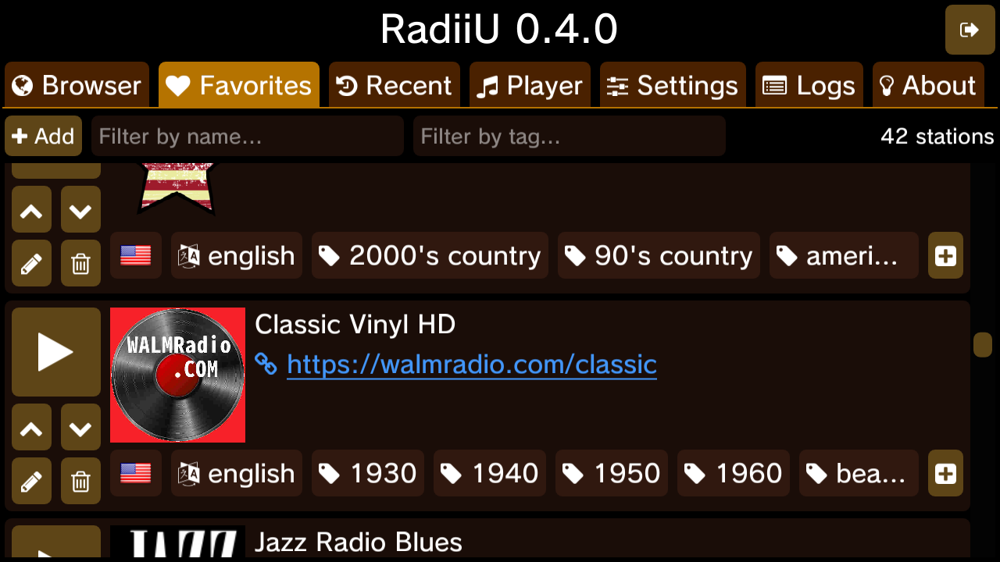
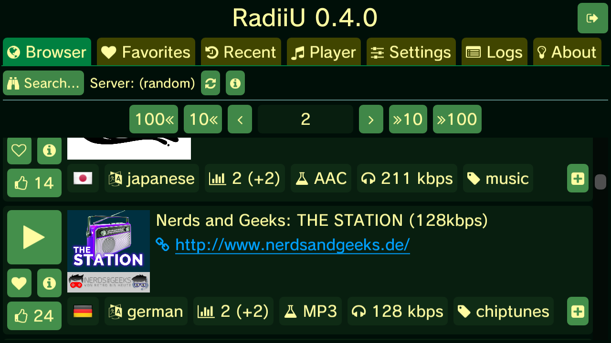
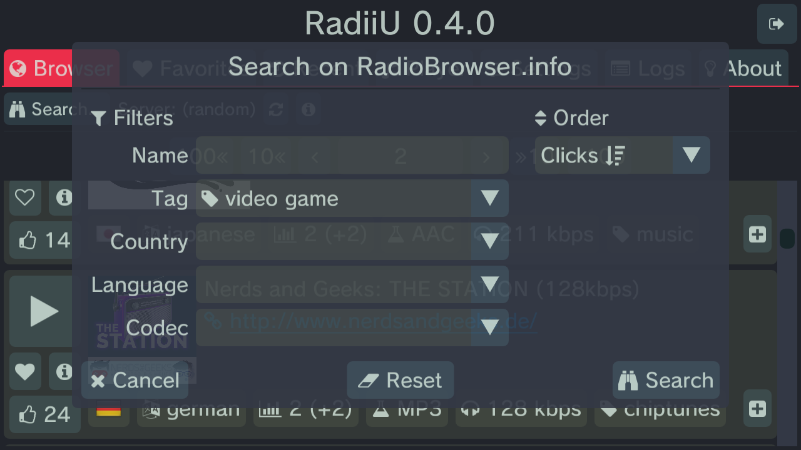
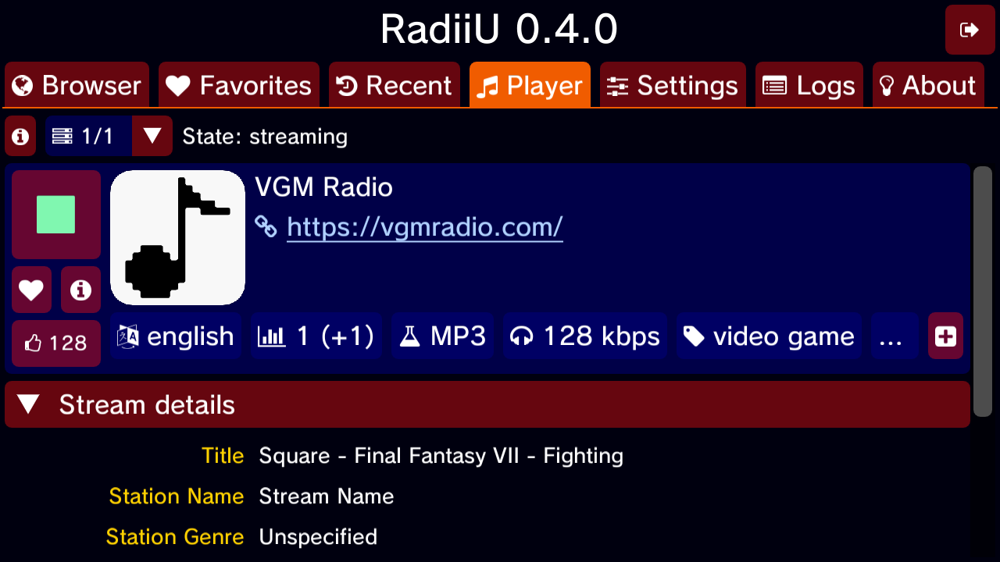

# RadiiU

<p align="center">
    <a href="https://hb-app.store/wiiu/RadiiU">
        
    </a>
</p>

This is an internet radio player app for the Wii U.

The stations list is provided by [www.radio-browser.info](https://www.radio-browser.info)
for free. You can donate to them to ensure the project continues running.











## Features and customization

### Save folder

When loading homebrew from the SD card, Aroma will redirect the save file to the SD card, inside
`SD:/wiiu/apps/save/`. Check the **About** tab in RadiiU, to see what the SD save path is. User
preferences, station history, track history, etc, are all stored in that folder.


### Additional fonts

When some text fails to render, because of missing glyphs, you can load custom fonts to fill in
the missing glyphs.

- Create a `fonts` folder inside the save folder.

- The fonts have to be `.ttf`, `.otf` or `.woff2`.

> Note: right-to-left text does not render correctly. This is a limitation of the ImGui library.


### Styles

Some color styles are defined in [`assets/content/styles`](assets/content/styles). You can
create a `styles` folder inside the save folder, and put your own custom styles there.

The [`GenerateTheme.py`](tools/GenerateTheme.py) is a Python script to help generate a color
style from a set of basic colors. Use that if you prefer to create a color style from scratch.


### USB Keyboard

If you have a USB keyboard connected to your Wii U, and you don't want to use the software
keyboard (SWKBD), you can turn off the "Use SWKBD" option in the **Settings** tab.


### Sending statistics and votes

Sending station playback and votes is an opt-in feature. Turn on the "Send clicks and votes"
option in the **Settings** tab, if you want the Radio Browser service to know what stations you
play and vote.

> Note: Radio Browser limits voting to once per day. RadiiU does no send unique information to
> Radio Browser, only your IP address is used to determine if you already voted.


## Build instructions

### Dependencies

- `ppc-freetype`

- `ppc-faad2`

- `ppc-mpg123`

- `ppc-opusfile`

- `ppc-vorbisfile`

- SDL2

- SDL2_image

- SDL2_ttf

- libcurl
  - Wii U curl package: https://github.com/dkosmari/wiiu-curl-package
  - Wii U mbedtls package: https://github.com/dkosmari/wiiu-mbedtls-package

- fontconfig (only for native build)


### Obtaining the source

- Via mercurial:
  - `hg clone https://github.com/dkosmari/RadiiU.git`

- Via git:
  - `git clone --recurse-submodules --shallow-submodules https://github.com/dkosmari/RadiiU.git`

After checking out the code, run:

```
./bootstrap
```

(This needs to only be done once, to create the `configure` script.)


### Wii U build

```
./configure --enable-wiiu --host=powerpc-eabi
make
```

If the Wii U is named `wiiu` in your local network, you can run:

- `make run`
  - This will use `wiiload` to run it on the Wii U without installing.

- `make wiiu-install`
  - This will install `radiiu.wuhb`, via ftp.

- `make wiiu-uninstall`
  - This will uninstall `radiiu.wuhb`, via ftp.

### Native build

This has only been tested on GNU/Linux environments so far.

```
./configure
make
make run
```

Note that the native build is meant to be run from the top level source code directory,
where it can find `assets/content`. The `make run` command will `cd` into the correct
directory before executing the program, so the app works properly even when building
outside the source tree.
 
It's recommended to have the Wii U's `Cafe*.ttf` fonts installed where fontconfig can find
them (`~/.local/share/fonts/` or `/usr/share/fonts`) to match the Wii U's appearance.
